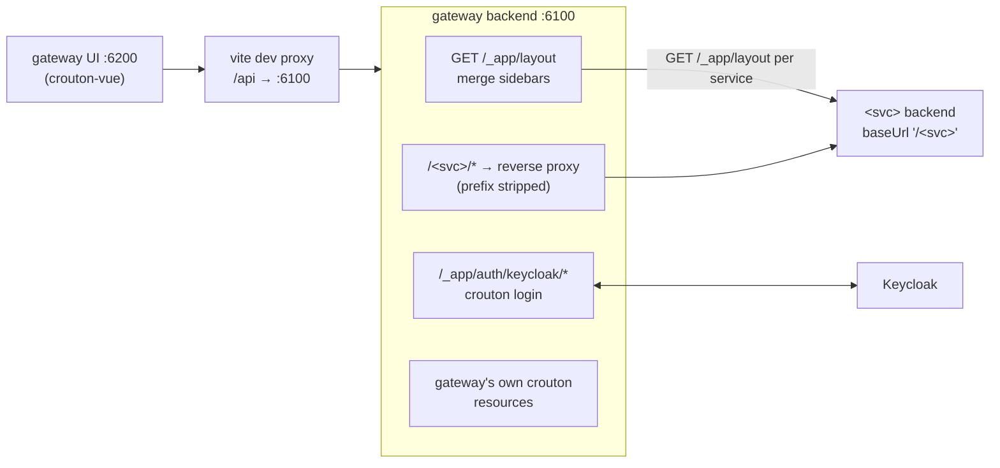
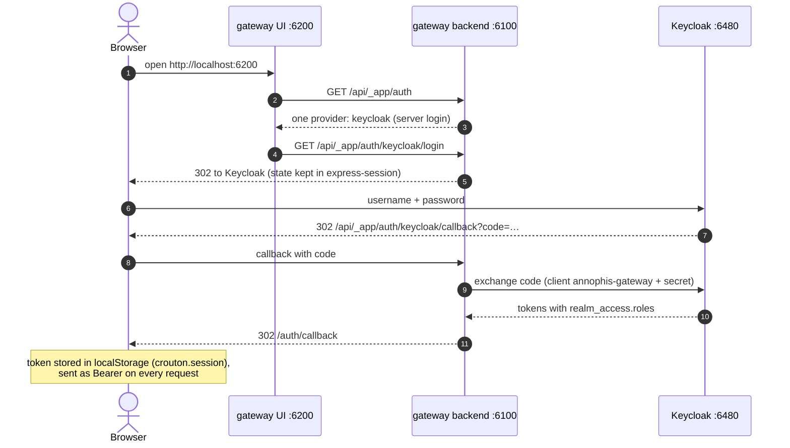
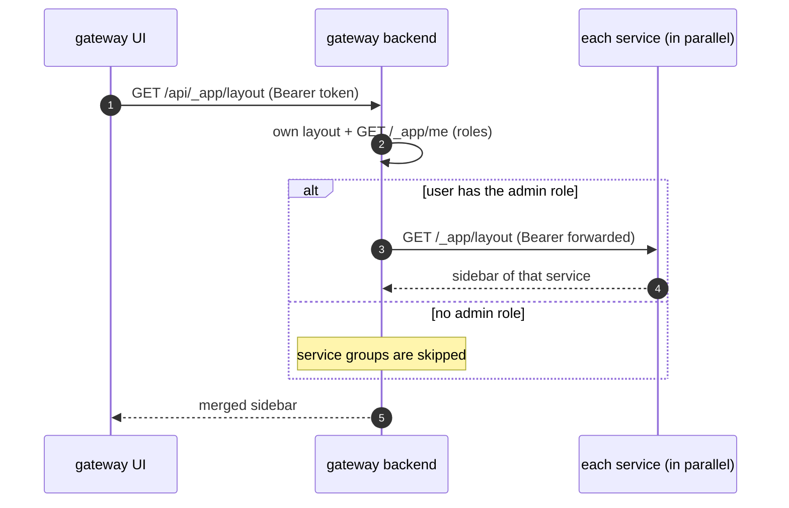
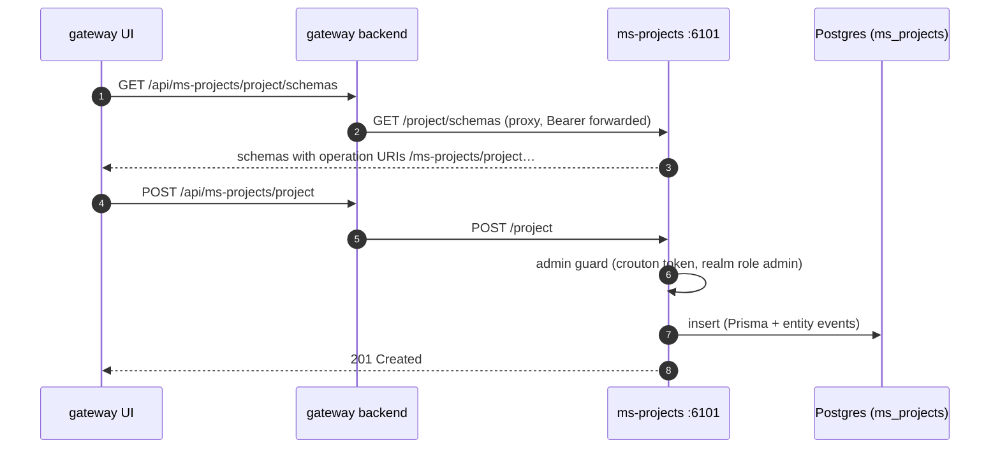

# The admin gateway: one UI for every service

There is **one** admin UI: the gateway's crouton frontend at http://localhost:6200. Services have no frontend of their own.

crouton-vue talks to exactly one backend per app, so the **gateway backend acts as a facade**: to the UI it looks like a single crouton backend, while it actually fans out to every service.

Code: `apps/gateway/crouton-backend/src/admin-facade.ts`, `merge-layouts.ts`, `services.ts`.

## The pieces

## Logging in

One login at the gateway gives a **crouton session token** (a JWT signed with `CROUTON_AUTH_SECRET`). Every backend shares that secret, so the same token works for all services.

## One sidebar for all services

`mergeLayouts` keeps the gateway's own items at the top level and adds **one group per service** (title from `services.ts`). Every leaf is prefixed so it stays unique and routes through the proxy:

| Service sends | Merged sidebar gets |
|---|---|
| `{ id: 'project', route: 'project' }` | `{ id: 'ms-projects.project', route: 'ms-projects/project' }` |

A service that is down is skipped, with a warning in the gateway log.

Service URLs come from `ANNOPHIS_<SVC>_URL` (e.g. `ANNOPHIS_MS_PROJECTS_URL`), falling back to `http://localhost:<port>` for `pnpm dev`.

## Health of the whole stack

`GET /api/health/services` (public) calls the gateway and every service's `/health`. It returns `{ status: 'ok' | 'degraded', services: [...] }`: HTTP 200 when everything is up and on the bus, 503 otherwise. Compose and Nomad use it as the gateway's health check.

In the UI: **http://localhost:6200/system-status** shows the same data as a table that refreshes every 10 s. It requires a login, like the rest of the admin. The raw JSON is at `/api/health/services`. Each row shows:
- status and event-bus connection (`/health`);
- the crouton self-check summary (`/crouton/status.json`: database and resource errors), which also counts towards the overall status. Below the table, a collapsible block per service shows the main parts of crouton's status: app and crouton version, environment, databases, and resources (valid / invalid / warnings / draft / needs migration), problems first. Services with problems open automatically;
- links to the service's **API docs** (Swagger at `/api/<svc>/docs`, the gateway's at `/api/docs`) and its crouton status JSON.

Every service's OpenAPI document lists two servers: `/api/<svc>` (through the gateway) and `/` (the service directly). Swagger's "Try it out" therefore works from the admin UI.

## Opening and editing a resource

Because each service sets `baseUrl: '/<svc>'`, the URIs it puts in its schemas already carry the prefix. The UI just calls them under `/api`.

## Adding a service to the admin UI
1. In the service's `app.module.ts`: `CroutonApiModule.forResourceDir(..., { baseUrl: '/<svc>' })`.
2. In `apps/gateway/crouton-backend/src/services.ts`: add `{ name, title, port }`.

The `annophis-add-service` skill has the full checklist.

## Limits (by design, for now)
- One `isDev`/language setting for the whole UI, the gateway's.
- No relations *between* services in the admin. Relations inside one service work.
- The admin writes straight to the databases, so **never expose it publicly**. It needs the Keycloak `admin` role.
- A crouton feature, "multi-backend frontend" (one crouton context per route subtree), would make this facade unnecessary.
