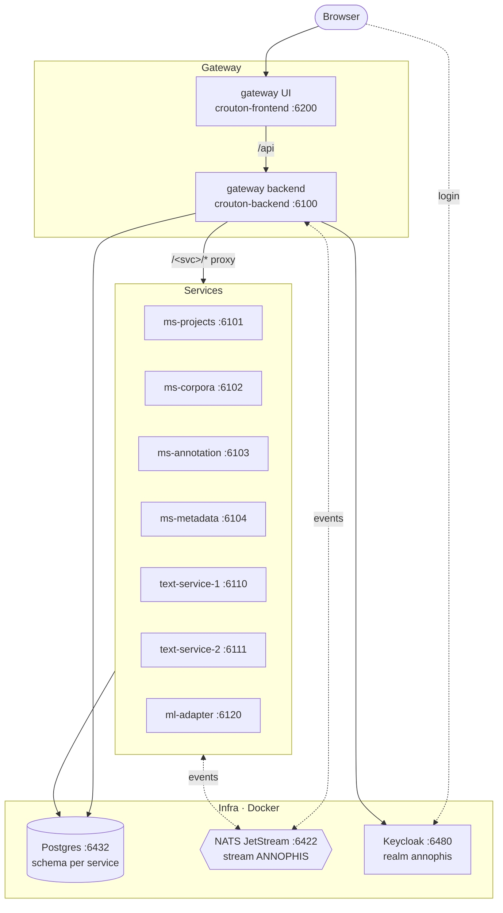
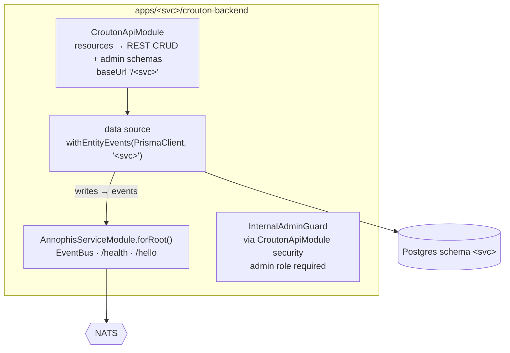
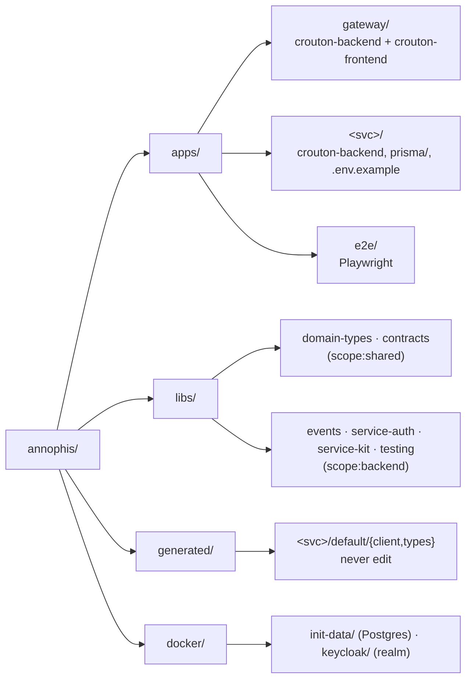

# Architecture

Annophis is a set of small services. Each **owns its data** (its own Postgres schema) and talks to the others only through **REST** or **events on the bus**. The **gateway** is the only entry point for browsers.

## Overview

- **Gateway UI** is the only frontend. It is the crouton admin for *all* services (see [admin-gateway.md](admin-gateway.md)).
- **Gateway backend** logs users in with Keycloak, merges the service admins into one sidebar, and proxies `/<svc>/*` to the services.
- **Services** are crouton/NestJS backends. Each has its own Postgres schema (`ms_projects`, …), publishes entity events and can subscribe to others (see [events.md](events.md)).
- **ml-adapter** bridges to external ML models. The text services serve text collections.

## What every backend contains

| Piece | Where | Purpose |
|---|---|---|
| crouton resources | `crouton-backend/src/app/resources/*/resource.json` | REST CRUD + the admin UI definition, generated from Prisma |
| admin guard | `app.module.ts` → `CroutonApiModule` `security` option | `InternalAdminGuard` verifies the gateway's `X-Internal-Token` and requires `admin` |
| data source | `crouton-backend/src/app/data-sources/default/index.ts` | the Prisma client, wrapped with `withEntityEvents` |
| service kit | `@annophis/service-kit` | event bus, `/health`, `/hello` |
| contracts | `@annophis/contracts` | Zod schemas for DTOs and events: the single source of truth |

## Repository layout

Module boundaries are enforced by lint: backend never imports frontend code, shared libs stay framework-free, and apps never import other apps. See the table in [AGENTS.md](../AGENTS.md#module-boundaries-enforced-by-lint).

## Running it

| Mode | Command | When |
|---|---|---|
| Infra in Docker, apps on the host | `docker compose up -d postgres nats keycloak` + `pnpm dev` | day-to-day development, and what CI's e2e does |
| Everything in Docker | `docker compose up` | a quick demo; heavy (one dev container per app) |

Ports live in fixed ranges so Annophis runs next to other stacks: backends 61xx, UI 62xx, infra 64xx.
