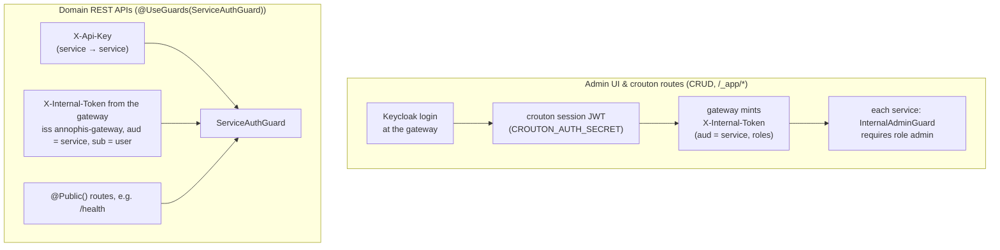
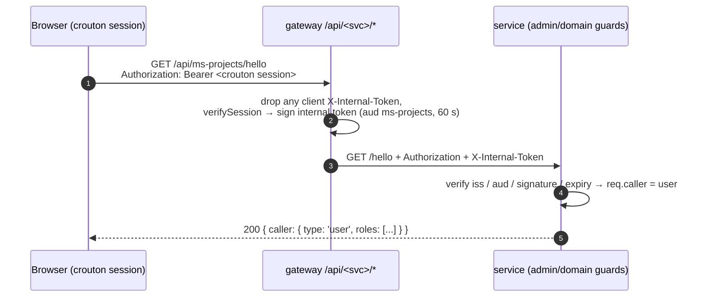

# Auth

There are two separate questions: **may this person use the admin?**, answered by Keycloak plus crouton at the gateway, and **may this caller use a service's API?**, answered by `X-Internal-Token` and/or `X-Api-Key`.

## Admin access
- Users and roles live in the Keycloak realm `annophis` (`docker/keycloak/annophis-realm.json`). The dev users are `admin`/`admin` (roles admin, editor, viewer) and `viewer`/`viewer`.
- The gateway does a **server-side login** with the confidential client `annophis-gateway` and issues a crouton session JWT. The OIDC `state` during the redirect lives in an `express-session` stored in Postgres (`gateway.session`, Prisma model `Session`), so several gateway instances can share it. **Only the gateway** has an auth-provider and shares `CROUTON_AUTH_SECRET`; services have no Keycloak/auth-provider config.
- The gateway proxy mints a short-lived `X-Internal-Token` (aud = the service, roles from the session). Each service's crouton CRUD routes use `InternalAdminGuard` (via the `security` option in `CroutonApiModule`) to verify it and require the `admin` role. A user without it is refused by every service (403), and the merged sidebar shows no service groups.

## Service-to-service and domain APIs
`ServiceAuthGuard` (`@annophis/service-auth`) is **opt-in**: put `@UseGuards(ServiceAuthGuard)` on domain controllers. It is not global, because crouton's own routes use `InternalAdminGuard`. The sample is the guarded `GET /hello` in `AnnophisServiceModule`.

| Caller | Sends | Accepted when | `req.caller` |
|---|---|---|---|
| a user, through the gateway | `X-Internal-Token` (added by the gateway) | HS256 with `INTERNAL_JWT_SECRET`, `iss` = `annophis-gateway`, `aud` = the target's `SERVICE_NAME`, not expired (60 s) | `{ type: 'user', userId, email, roles }` |
| another service | `X-Api-Key: <its SERVICE_API_KEY>` | the key is in the target's `SERVICE_API_KEYS` | `{ type: 'service' }` |
| anyone | nothing | the route is marked `@Public()` | — |

- **Two headers, two jobs.** `Authorization` carries the crouton session, only for the gateway's own crouton routes and login. `X-Internal-Token` carries the gateway's token for every service route: crouton CRUD (`InternalAdminGuard`) and domain routes (`ServiceAuthGuard`).
- **Only the gateway mints internal tokens.** It strips any `X-Internal-Token` a client sends.
- **Service auth is on by default** (`SERVICE_AUTH=on`). `off` disables the check for quick local experiments only.
- **API keys:** each service sends its own `SERVICE_API_KEY`. In dev every service accepts all dev keys; in production, list only the real callers.
- Any verification failure is a 401.

## Secrets (dev values, never use in production)

| Env | Used by | Purpose |
|---|---|---|
| `CROUTON_AUTH_SECRET` | gateway | sign and verify admin session tokens |
| `KEYCLOAK_URL`, `KEYCLOAK_REALM`, `KEYCLOAK_CLIENT_ID` | gateway | OIDC login (`annophis-gateway` client) |
| `KEYCLOAK_CLIENT_SECRET` | gateway | server-side login (`annophis-gateway` client) |
| `INTERNAL_JWT_SECRET` | all backends | the gateway signs, services verify `X-Internal-Token` |
| `SERVICE_API_KEY` | all backends | the key this service sends as `X-Api-Key` |
| `SERVICE_API_KEYS` | all backends | keys accepted from other services |
