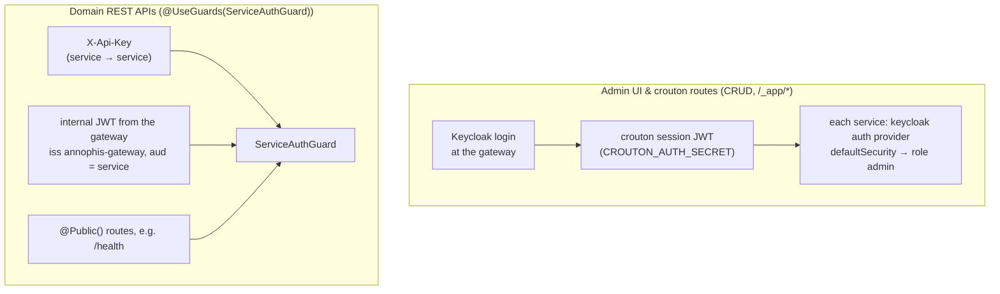

# Auth

There are two separate questions: **may this person use the admin?**, answered by Keycloak plus crouton, and **may this caller use a service's domain API?**, answered by `ServiceAuthGuard`.

## Admin access
- Users and roles live in the Keycloak realm `annophis` (`docker/keycloak/annophis-realm.json`). The dev users are `admin`/`admin` (roles admin, editor, viewer) and `viewer`/`viewer`.
- The gateway does a **server-side login** with the confidential client `annophis-gateway` and issues a crouton session JWT. Every backend shares `CROUTON_AUTH_SECRET`, so every backend accepts it.
- Each project's `auth-providers/keycloak/auth-provider.json` requires the `admin` realm role on all crouton routes. A user without it is refused by every service (403), and the merged sidebar shows no service groups.

## Service-to-service and domain APIs
`ServiceAuthGuard` (`@annophis/service-auth`) is **opt-in**: put `@UseGuards(ServiceAuthGuard)` on domain controllers. It is not global, because crouton's own routes use crouton auth.

| Caller | Sends | Accepted when |
|---|---|---|
| another service | `X-Api-Key` | the key is in the target's `SERVICE_API_KEYS` |
| the gateway, for a user | `Authorization: Bearer <internal JWT>` | HS256 with `INTERNAL_JWT_SECRET`, `iss` = `annophis-gateway`, `aud` = the target's `SERVICE_NAME` |
| anyone | nothing | the route is marked `@Public()` |

- `SERVICE_AUTH=off` in `.env` disables the check for local development.
- Any verification failure is a 401.

> **Phase 1:** the guard already accepts gateway-issued internal JWTs, but the gateway does not mint them yet. It will once the gateway starts calling domain APIs for users, the BFF part of the gateway.

## Secrets (dev values, never use in production)

| Env | Used by | Purpose |
|---|---|---|
| `CROUTON_AUTH_SECRET` | all backends | sign and verify admin session tokens |
| `KEYCLOAK_CLIENT_SECRET` | gateway | server-side login (`annophis-gateway` client) |
| `INTERNAL_JWT_SECRET` | all backends | verify gateway-issued internal JWTs |
| `SERVICE_API_KEYS` | all backends | accepted service-to-service keys |
