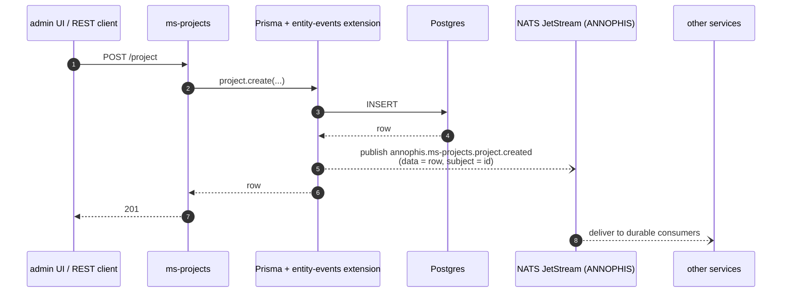
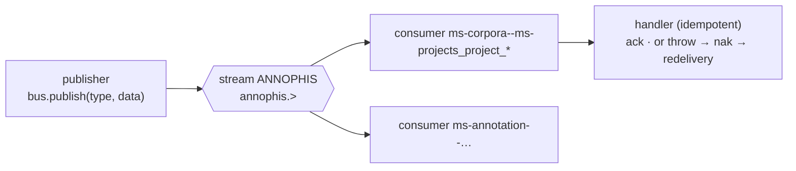

# Events

Services never read each other's databases. They react to **events** on NATS JetStream.

- **Stream:** `ANNOPHIS`, subjects `annophis.<type>`.
- **Code:** `@annophis/events` (`EventBus`, `withEntityEvents`) and `@annophis/contracts` (event schemas).

## Entity events: every write announces itself

Each service wraps its Prisma client: `withEntityEvents(new PrismaClient(...), '<svc>')`. **Every** successful write then publishes an event, including writes made through the admin UI, so controllers never publish entity events themselves.



| Write | Event type | `data` |
|---|---|---|
| `create`, `createManyAndReturn` | `<svc>.<model>.created` | the row (one event per row) |
| `update`, `upsert`, `updateManyAndReturn` | `<svc>.<model>.updated` | the row |
| `delete` | `<svc>.<model>.deleted` | the deleted row |
| `createMany` / `updateMany` / `deleteMany` | same verbs | `{ count, where }` |

Each event is wrapped in an envelope `{ id, type, source, time, subject, dataVersion, data }`, validated by `EntityChangedEvent` in `@annophis/contracts`.

**Delivery is fire-and-forget after the write.** A NATS outage is logged and drops the event, but never fails the write. Inside an interactive transaction an event can precede the commit. Switch to a transactional outbox when that matters.

## Subscribing



```ts
await bus.subscribe('ms-projects.project.*', async (event) => {
  const e = EntityChangedEvent.parse(event); // validate with the contract
  // … idempotent side effect, dedupe on e.id if needed
});
```

- One **durable consumer per service and filter**, so a restarted service resumes where it stopped.
- A handler that throws is NAKed and the message is redelivered, so handlers must be idempotent.
- Phase-0 smoke test: on start, every service publishes `<svc>.hello` and logs the hellos of all the others.

## Watching the bus
- Monitoring: http://localhost:6482
- Live tail: `docker run --rm -it --network annophis-net natsio/nats-box nats sub -s nats://nats:4222 'annophis.>'`

See the `annophis-events` and `annophis-contract` skills for adding events.
