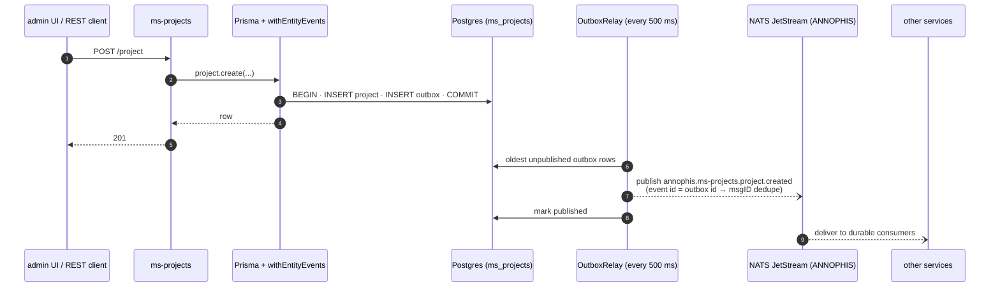
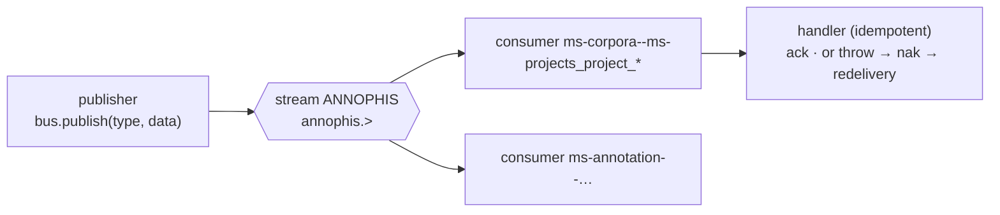

# Events

Services never read each other's databases. They react to **events** on NATS JetStream.

- **Stream:** `ANNOPHIS`, subjects `annophis.<type>`.
- **Code:** `@annophis/events` (`EventBus`, `withEntityEvents`) and `@annophis/contracts` (event schemas).

## Entity events: every write announces itself (transactional outbox)

Each service wraps its Prisma client: `withEntityEvents(new PrismaClient(...), '<svc>')`. **Every** successful write, including those made through the admin UI, stores its event in the service's `outbox` table **in the same database transaction**. The `OutboxRelay` (part of `AnnophisServiceModule`) then publishes it to NATS. Controllers never publish entity events themselves.



| Write | Event type | `data` |
|---|---|---|
| `create`, `createManyAndReturn` | `<svc>.<model>.created` | the row (one event per row) |
| `update`, `upsert`, `updateManyAndReturn` | `<svc>.<model>.updated` | the row |
| `delete` | `<svc>.<model>.deleted` | the deleted row |
| `createMany` / `updateMany` / `deleteMany` | same verbs | `{ count, where }` |

Each event is wrapped in an envelope `{ id, type, source, time, subject, dataVersion, data }` (validated by `EntityChangedEvent` in `@annophis/contracts`). `id` is the outbox row id and `time` its creation time.

**Delivery guarantees:**
- **An event exists if and only if the change is committed.** A failed write leaves no event, and a committed write always has one.
- **A NATS outage doesn't lose events.** Writes keep working, and rows wait in the outbox until NATS is back. Tested: a project created with NATS stopped was published within seconds of NATS restarting.
- **At least once, in order per service.** A re-published event has the same id, so JetStream drops duplicates within its dedupe window, and consumers dedupe on `event.id`.
- **Caveat:** a write inside a caller's own interactive transaction (`$transaction(async tx => …)`) runs in a separate transaction, so it is not atomic with the caller's other statements.
- **Outbox table:** every service's Prisma schema has `model Outbox` (table `outbox`), excluded from crouton via `excludeTables` in `data-source.json`. `OUTBOX_RELAY_INTERVAL_MS` sets the polling interval (default 500).

## Subscribing



```ts
await bus.subscribe('ms-projects.project.*', async (event) => {
  const e = EntityChangedEvent.parse(event); // validate with the contract
  // … idempotent side effect, dedupe on e.id if needed
});
```

- One **durable consumer per service and filter**, so a restarted service resumes where it stopped.
- A handler that throws is NAKed and the message is redelivered, so handlers must be idempotent.
- Phase-0 smoke test: on start, every service publishes `<svc>.hello` and logs the hellos of all the others.
- `pnpm nx run events:integration` tests the `EventBus` against real NATS: delivery with the envelope, and redelivery after a handler throws. It runs in CI's e2e workflow.

## Watching the bus
- Monitoring: http://localhost:6482
- Live tail: `docker run --rm -it --network annophis-net natsio/nats-box nats sub -s nats://nats:4222 'annophis.>'`

See the `annophis-events` and `annophis-contract` skills for adding events.
