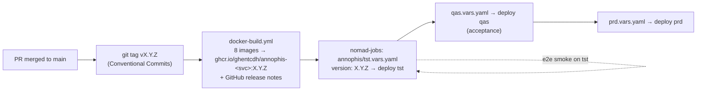
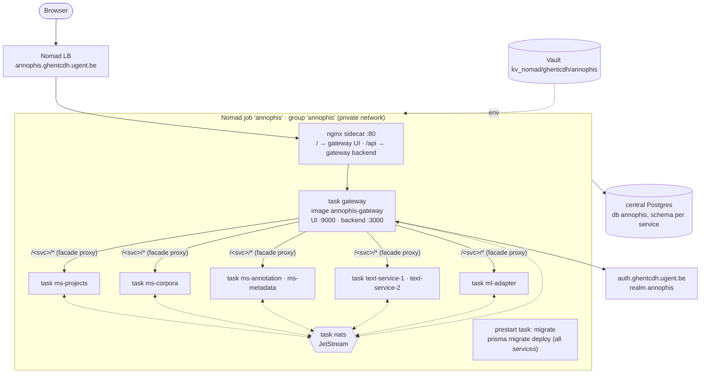

# Release to production (Nomad)

> **Status: proposal.** Nothing is deployed yet. This describes how Annophis goes from a git tag to running on the GhentCDH Nomad cluster, following the conventions of [`nomad-jobs-ns-ghentcdh`](https://github.ugent.be/containers/nomad-jobs-ns-ghentcdh) (see `new_polities`, `mela` and `keycloak` there). Items marked **TODO (phase 1)** must be done before the first deploy.

## Principles

- **One image per service.** There is no PM2 and no combined image. In Nomad each service is its own **task** (container), so it gets its own memory limit, restarts and logs.
- **One Nomad job `annophis`** with one **group**. Tasks in a group share a private network, so the gateway reaches services without service discovery. This is the same pattern as `new_polities` and `mela`.
- **Shared infrastructure is reused**, not shipped:
  - Postgres is the central GhentCDH database server.
  - Keycloak is the shared `auth.ghentcdh.ugent.be`, with a realm `annophis`.
- **Only the gateway is reachable from outside**, through the Nomad load balancer (`nomad-lb` tag). Services, NATS and the admin API stay inside the group.
- **Environments:** `tst` → `qas` → `prd`, one `<env>.vars.yaml` each. The same image tag is promoted through all three; it is never rebuilt.

## The release flow



1. **Tag:** `git tag v0.1.0 && git push --tags` on `main`. Releases are cut from `main` only.
2. **Build:** `.github/workflows/docker-build.yml` builds one image per service for amd64 and arm64, pushes `ghcr.io/ghentcdh/annophis-<svc>:<version>` plus `:<major>.<minor>` and `:latest`, and creates a GitHub release with notes from the Conventional Commits.
3. **Pull through Nexus:** Nomad pulls from `nexus.ugent.be/docker-group-nomad-<env>/…`, as every GhentCDH job does. **TODO (phase 1):** confirm with the infra team that the Nexus group proxies `ghcr.io/ghentcdh`, or whether images must be pushed to Nexus as well.
4. **Deploy:** bump the version in `annophis/<env>.vars.yaml` in the nomad-jobs repo and deploy that environment, `tst` first. The job's `update { max_parallel = 1 }` rolls one allocation at a time.
5. **Promote:** after checks on `tst`, set the same version in `qas`, then `prd`.

## What runs in the Nomad job



| Dev (docker compose) | Production (Nomad) |
|---|---|
| `compose.infra.yml` Postgres container | central GhentCDH Postgres. DB `annophis` with a user and schema per service, created once by the DBA. |
| Keycloak container, realm JSON auto-imported | shared `auth.ghentcdh.ugent.be`: import `docker/keycloak/annophis-realm.json` once, then set production redirect URIs and secrets. No dev users. |
| NATS container | `nats` task in the group, with JetStream storage on a CSI volume (see `volumes/` in the nomad-jobs repo). JetStream prefers local disk, so check NFS performance or use a host volume. |
| Vite proxy `/api` → gateway backend | nginx sidecar `/api` → gateway backend, as in `new_polities`. The gateway image's Caddy only serves the UI. |
| `.env.example` defaults | Vault `kv_nomad/ghentcdh/annophis`, rendered into each task's env with a `template` block |
| service URLs `localhost:61xx` / `<svc>-backend` | services on their own ports inside the group. The gateway reads service URLs from env (**TODO (phase 1)**, see below). |
| backends run `prisma migrate deploy` on start (compose command) | `migrate` **prestart** task before the services start (**TODO (phase 1)**). The prod images don't migrate. |

### Sketch of the job template

```hcl
# annophis/job.nomad.hcl.j2 (sketch, follows new_polities)
[% from "base/network.j2" import network_block -%]
[% from "base/task.j2" import task_podman -%]

job "[[ job_name ]]" {
  type      = "service"
  namespace = "ghentcdh"
  vault {}
  update { stagger = "30s"  max_parallel = 1 }

  group "annophis" {
    [[ network_block(network="private", ports={
         "http": {"to": 80}, "gateway_ui": {"to": 9000}, "gateway_api": {"to": 3000},
         "ms_projects": {"to": 6101}, "ms_corpora": {"to": 6102}, "nats": {"to": 4222} }) ]]

    task "gateway"     { [[ task_podman(image=images.gateway,     memory=512, ports=["gateway_ui", "gateway_api"]) ]] }
    task "ms-projects" { [[ task_podman(image=images.ms_projects, memory=384, ports=["ms_projects"]) ]] }
    # … one task per service, each with a template { … secret "kv_nomad/ghentcdh/annophis" … } env block
    task "nats"        { /* nats:2-alpine -js -sd /data, CSI volume */ }
    task "migrate"     { lifecycle { hook = "prestart" }  /* prisma migrate deploy per service */ }
    task "nginx"       { /* sidecar: / → NOMAD_ADDR_gateway_ui, /api → NOMAD_ADDR_gateway_api;
                            service with tags ["nomad-lb"], meta nomad-lb-vhost-fqdn = annophis[.<env>].ghentcdh.ugent.be */ }
  }
}
```

```yaml
# annophis/prd.vars.yaml
version: 0.1.0
images:
  gateway:     nexus.ugent.be/docker-group-nomad-prd/ghentcdh/annophis-gateway:0.1.0
  ms_projects: nexus.ugent.be/docker-group-nomad-prd/ghentcdh/annophis-ms-projects:0.1.0
  # …
```

## Configuration and secrets

Every task gets its env from Vault (`kv_nomad/ghentcdh/annophis`):

| Key | Notes |
|---|---|
| `DATABASE_URL` per service | `postgresql://<svc_u>:…@<pg-host>:5432/annophis?schema=<svc_u>`. Use one Vault key per service, e.g. `MS_PROJECTS_DATABASE_URL`, mapped in that task's template. |
| `NATS_URL` | `nats://{{ env "NOMAD_ADDR_nats" }}` |
| `KEYCLOAK_URL`, `KEYCLOAK_REALM`, `KEYCLOAK_CLIENT_ID` | `https://auth.ghentcdh.ugent.be`, `annophis` |
| `KEYCLOAK_CLIENT_SECRET`, `KEYCLOAK_CALLBACK_URL`, `CROUTON_FRONTEND_URL` | gateway only; production URLs |
| `CROUTON_AUTH_SECRET` | one long random value, the same for **all** backends |
| `INTERNAL_JWT_SECRET`, `SERVICE_API_KEYS` | real values, with `SERVICE_AUTH` on |
| `SERVICE_NAME`, `BACKEND_PORT` | per task, can live in the job template itself |

## Releases, migrations and rollback

- **Versioning:** SemVer tags, with release notes generated from Conventional Commits (PR titles are enforced by `pr-title.yml`).
- **Migrations are forward-only.** The `migrate` prestart task runs `prisma migrate deploy` before the new version starts. Write migrations that the *previous* version can still run against: expand first, contract in a later release.
- **Rollback:** set the previous version in `<env>.vars.yaml` and redeploy. A schema migration is not rolled back, which is why expand/contract matters.
- **Events across versions:** `dataVersion` in the event envelope lets consumers handle old and new payloads during a rolling update (see the `annophis-contract` skill).

## Who can reach what

- The **admin UI is the gateway**, and the admin writes straight to the databases. It is protected by the Keycloak `admin` role. For `prd`, also decide whether to restrict the vhost to the UGent network or VPN, as other internal GhentCDH tools do.
- Services, NATS and the migrate task have no load-balancer service, so they're only reachable inside the group.
- Health: the nginx service check calls `/` (the UI). **TODO (phase 1):** add a gateway endpoint that reports every service's `/health`, and use it as the Nomad check.

## TODO before the first deploy (phase 1)

1. The gateway reads service URLs from env (`ANNOPHIS_<SVC>_URL`) instead of the `IS_DOCKER`/`localhost` switch in `apps/gateway/crouton-backend/src/services.ts`.
2. A migrate step for production (prestart task or entrypoint flag), since the prod images don't run `prisma migrate deploy`.
3. Confirm Nexus ↔ ghcr image pulls with the infra team.
4. Create the `annophis` folder in the nomad-jobs repo (`job.nomad.hcl.j2` plus `tst`/`qas`/`prd` vars) and the Vault secrets.
5. Create the DB `annophis` (users, schemas, `GRANT CREATE ON DATABASE`) on the central Postgres, and the realm `annophis` on `auth.ghentcdh.ugent.be`.
6. NATS JetStream storage: a CSI volume or host volume, plus a retention policy for stream `ANNOPHIS`.
7. An aggregated health endpoint for the Nomad check, and a smoke test (the e2e suite against `tst`).
8. Register the application, domains and healthchecks in auto (`auto:audit` skill, or the `auto` MCP server in `.mcp.json`).
